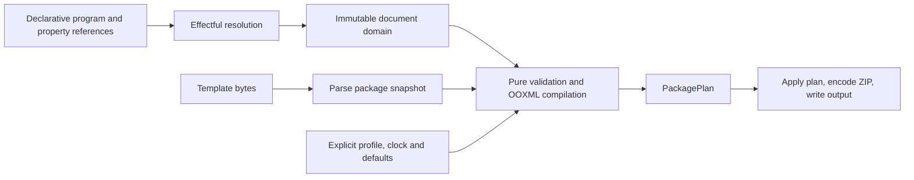

# Architecture review and proposed direction

Status: review of commit `85faea7`; the module tree and APIs below are proposals,
not descriptions of code already implemented. This documentation change does
not refactor the runtime. CMI inspired the initial interface and provides useful
regression fixtures; matching its interface or incidental behavior is **not** a
future design constraint. The intended direction is a declarative API, domain
driven design, a functional core, direct OOXML generation, and few runtime
dependencies.

## Assessment

The current implementation is a reasonable small generator for its implemented
surface. The existing separation of declarations from resolved Rust snapshots,
explicit deferred values, direct ZIP/XML output, reused formatting functions,
and independent Python readback/mutation tests are foundations to retain.

The main obstacle to broader DOCX support is the coupling between document
semantics, package mutation, template editing, and language adaptation. Splitting
large files alone will preserve that coupling. Establish responsibility and data
boundaries first, then move code behind them.

“Full DOCX support” needs separate measures: authoring a feature, interpreting
it, editing it safely, preserving unknown content, and producing conforming
output for a declared profile. An untouched ZIP part surviving a template edit
does not establish that unknown XML survives inside a rewritten part. Producing
OOXML also does not implement Word's pagination, font shaping, field evaluation,
or chart layout engines. The [standards map](OOXML.md) distinguishes current
coverage from the larger format.

## Findings, in priority order

### 1. XML names and preservation are the first correctness boundary

Evidence: [xml.rs](../src/xml.rs), `Node::{parse,namespaces,sort_properties}`,
and [package.rs](../src/package.rs), `Package::put`.

`Node` stores prefix-qualified strings, not expanded names `(namespace URI,
local name)`. Parsing normalizes known prefixes and adds a fixed namespace map;
serialization then relies on the remaining lexical declarations. Attribute
values containing prefix names are opaque strings. `Package::put` recursively
sorts recognized property elements even in template content.

A probe against the public Python template API confirmed a semantic change:
inside an ignorable extension subtree that locally binds `w` to another URI,
an input `main:p` in the WordprocessingML namespace is rewritten as `w:p` in
the shadow namespace. The document remains parseable XML. That is a preservation
failure, not merely a different namespace-prefix spelling.

Use expanded names for semantic lookup, an explicit namespace environment for
writing, and preservation of lexical namespace dependencies for opaque content.
Separate newly generated nodes from imported nodes. Schema ordering belongs in
typed serializers for generated/changed properties; it should not be a blanket
normalization of imported XML. Define whether each edit promises semantic
preservation or exact bytes. Untouched part payloads can retain exact bytes;
rewriting ZIP metadata or editing XML cannot promise an identical archive.

Required foundations: [XML namespaces](OOXML.md#xml-and-compatibility), ECMA-376
Part 3 §§7–9, and the relevant Part 1 schema content models.

### 2. Packaging needs an OPC boundary and a relationship graph

Evidence: [package.rs](../src/package.rs), `Package::{load,relation,related}`;
[render.rs](../src/render.rs), `Renderer::{image,header_footer}` and
`render_with_template`.

`Package::load` requires `word/document.xml`, seeds Word styles/settings/numbering
from a bundled Word template, and scans selected Word filenames for drawing IDs.
It is both a generic package loader and a Word application service. Image
relationships derive their target by stripping `word/`, rather than computing a
relative reference from the source part. Relationship lookup combines type and
ID selection in string conventions; insertion has no external-target API.

A second probe renamed the main part to `word/main.xml`, renamed its `.rels`,
and updated the package relationship and content-type override. Rendering still
failed with `template must contain word/document.xml`. Main-part identity should
come from the package's office-document relationship.

Introduce validated `PartName`, `ContentType`, `RelationshipType`, and
`RelationshipId` value objects. Distinguish an internal `PartName` target from an
external URI. Scope relationship IDs to their source part; scope other identifier
allocators according to their own rules. Resolve targets centrally, and discover
stories through relationships. Keep default Word document construction above
OPC. Add explicit read budgets for expanded ZIP bytes, part counts, and XML depth;
these are application policies, not a claim about normative numeric limits.

Required foundations: [OPC](OOXML.md#packaging-and-part-identity), especially
Part 2 §§6.2, 6.4–6.5 and Part 1 §11.3.10.

### 3. The domain needs stories, rich content, ranges, and resources

Evidence: [model.rs](../src/model.rs), `Inline`, `ResolvedParagraph`,
`ResolvedTextRun`, `ResolvedInlineKind`; [components.rs](../src/components.rs);
[render.rs](../src/render.rs), `Renderer::comment`.

An image, tab, or break is currently represented as a `ResolvedTextRun` with an
extra kind field and a sometimes-empty text field. Paragraphs have a flat list
of runs. Comments are text strings attached to a paragraph or run; the renderer
wraps those nodes and always accesses comments through the fixed main-document
owner. The data model cannot naturally express nested hyperlinks, structured
content controls, fields, tracked changes, or ranges spanning several paragraphs.
Adding one renderer branch per feature will compound these restrictions.

Model `Story`, `Paragraph`, `Inline`, `Drawing`, `Field`, `Range`, and resource
references explicitly. A story identifies a body, header, footer, note, comment,
or text-box content region without equating that logical region with a package
part: several notes, for example, can share a part. Some content is recursive;
other content, such as bookmarks and comment anchors, requires paired range
markers with identity. One universal nested tree cannot express every overlap.
Parent/context rules must prevent unsupported story/range combinations.

Use a document aggregate to own story/resource references and their cross-object
invariants. Formatting, widths, colors, and IDs are value objects. Do not create
a service or trait object for every OOXML element, and do not equate a DDD
aggregate with a ZIP file or an XML element. Keep unrecognized imported markup
in the template/preservation representation rather than weakening every domain
type into an arbitrary attribute map.

References: [stories and rich content](OOXML.md#wordprocessingml-domain-map),
Part 1 §§17.5, 17.10–17.13, 17.16 and §20.4.

### 4. Make invalid authoring states harder to construct

Evidence: [model.rs](../src/model.rs), `Paragraph::{text,children}`;
[types.rs](../src/types.rs); [format.rs](../src/format.rs).

The Rust paragraph permits both optional text and optional children and rejects
invalid combinations at resolution time. Numeric fields mix points, inches,
EMU, twips, and multipliers. RGB tuples cannot express automatic/theme colors;
boolean underline cannot express underline styles. Font information does not
yet cover script/language/theme distinctions. Some false run-format values are
omitted to reproduce the initial behavior, which is insufficient as a general
formatting-inheritance model.

Prefer one paragraph content representation with convenient text/run builders;
use an enum for genuinely exclusive alternatives. Introduce `Points`, `Twips`,
`Emu`, `HalfPoints`, `Percentage`, and context-specific width/spacing types with
checked conversion. Model `Color::{Rgb,Theme,Auto}` and richer underline/font
values. Preserve “unspecified” separately from explicit false and interpret
style toggle rules in their actual context. Validation must distinguish domain
invariants, schema constraints, and chosen implementation limits.

These changes are allowed to diverge from CMI. Keep Python constructors pleasant
through defaults and small builders; Rust's exact constructor syntax need not be
copied into Python. References: [formatting and units](OOXML.md#formatting-and-units).

### 5. Separate the declarative program from the resolved document

Evidence: [value.rs](../src/value.rs), `Value`, `Deferred`;
[base.py](../python/rv_docx/declarative/base.py), `_Resolution`, `DeferredProperty`;
[document.py](../python/rv_docx/declarative/document.py).

Rust consumes producers into snapshots; Python replaces public declaration
fields in place and adds `_active` flags. Rust's shared `Deferred<T>` memoizes for
the lifetime of the handle, while Python references share field work per pass.
Only the Python field graph detects cycles. Rust has static formatting fields;
Python can resolve all declaration fields dynamically. These are meaningful
semantic differences, not just binding syntax.

Give authoring nodes stable identities and distinguish `Deferred<T>` (a shared
computation) from `PropertyRef<T>` (a dependency on a declared field). Define
cache lifetime, cancellation ownership, excluded-source behavior, error paths,
and rerender semantics once as a language-neutral contract. The current string
field API can be a convenience over validated field descriptors. Unresolved
producers belong to the authoring program; resolved domain values should contain
neither futures, paths awaiting I/O, mutable task state, nor `_active` flags.

Keep native futures and asyncio execution in their respective adapters. Share
the resolved domain model, identifiers, invariants, and contract fixtures; do not
force Python coroutines through a Rust executor simply to share scheduler code.
A future native property-graph interpreter can provide stronger Rust guarantees
without pretending it can inspect arbitrary user futures for cycles.

### 6. Turn rendering into feature compilers with explicit context

Evidence: [render.rs](../src/render.rs), `Renderer` and
`render_with_template`; [image.rs](../src/image.rs);
[components.rs](../src/components.rs), `ImageRun::resolve_at`;
[model.rs](../src/model.rs), `Document::resolve`.

The renderer currently combines text encoding, comments, images, tables,
headers/footers, sections, metadata, insertion, and package mutation. It repeatedly
parses/serializes part trees, scans existing media for identical bytes, and
allocates IDs during traversal. Model resolution obtains its timestamp from the
renderer and performs filesystem reads for image paths. Templates call back into
rendering to encode replacement text; packaging calls rendering to validate XML
characters. These dependency directions conceal shared lower-level operations.

Separate text/XML codecs, measurement conversion, relationship handling,
resource registration, and feature compilers. Pass a context containing the
story, source part, profile, available styles, resources, and allocators.
Compile with deterministic traversal into an explicit `PackagePlan` of part and
relationship changes. Apply the plan at the package boundary. A plan is an
internal value to validate and inspect, not a new public language users must
learn. Mutating a locally owned builder is compatible with a functional design;
cloning the entire document/package at every step is unnecessary.

Move clocks, path reads, and final writes to application functions. Resolve image
sources to registered assets before compiling the domain. Retain header-only
image inspection; it does not need pixel-decoding dependencies. Index resources,
relationships, style IDs, and parsed edited parts once per operation. Introduce
streaming or persistent collections only when measured workloads justify them.

### 7. Templates need explicit edit semantics and preservation policy

Evidence: [template.rs](../src/template.rs), `replacements`;
[render.rs](../src/render.rs), `render_with_template`.

Replacement discovers stories by filename, recursively flattens paragraph text,
and regenerates matching text/tab/break nodes. It has no explicit field,
revision, text-box, or content-control boundaries. Section properties are cloned
and mutated across insertion steps; header/footer inheritance is implicit.

Treat an imported document as an editable package snapshot with typed views and
opaque content, distinct from a newly authored domain document. Provide pure
edit operations with explicit targets and results, including diagnostics for
unsupported boundaries. Use a shared story traversal and text-span mapping.
Specify whether replacement can cross a hyperlink, field, revision, or control;
never silently choose semantics by recursively visiting all descendants. Reuse
OOXML text encoding and part/resource infrastructure, not an entire renderer.

### 8. The Python boundary should adapt languages, not define the domain

Evidence: [python_bindings.rs](../src/python_bindings.rs), `document`,
`paragraph`, and `rust_error`; [Python declarations](../python/rv_docx/declarative/).

Field lists appear in Python declarations, Rust declarations/resolved records,
and conversion functions. The adapter constructs ready Rust declarations and
runs Rust resolution again. It also reproduces CMI's extra excluded-final-section
behavior and identifies unknown-style errors by message prefix.

Partition conversion by document feature and translate a resolved Python program
into the canonical resolved domain. Share validation and a typed diagnostic
vocabulary; translate errors at the boundary, never by parsing display text.
Remove inherited quirks through deliberate behavior changes and corresponding
tests. An optional legacy adapter would only be warranted by real users; CMI
compatibility is not a reason to build one now. Keep `to_docx()` as a convenience
while making native bytes/save the primary dependency-light Python operations;
consider making python-docx interoperability optional in a future packaging change.

### 9. Tests must establish OOXML correctness independently of CMI

Evidence: [tests/features.rs](../tests/features.rs), `normalized`;
[Python differential tests](../tests/python_bindings/test_differential.py);
[readback verifier](../tests/python_docx/verify.py).

The existing content assertions and deliberate mutations are valuable. However,
normalization sorts property children, so an ordering error can disappear from
that comparison. python-docx accepts a subset of the format and is not an OOXML
conformance validator. CMI equality cannot establish semantics CMI does not model.

Organize tests by contract: domain invariants and pure transformations; resolution
DAG behavior; OPC names/targets; feature serialization; template preservation;
and consumer interoperability. Add schema-aware order/choice/cardinality checks,
cross-part/reference checks, and an independent Open XML validator pinned to the
chosen Office/profile version as development tooling. Add corpus fixtures for
relocated main parts, nested namespace bindings, MCE alternatives, extension
attributes, notes, fields, revisions, and package cycles. Mutation tests should
also detect invalid order and broken relationship targets. A schema validator
and a consumer readback check complement each other; neither proves visual layout.

Keep pinned upstream fixtures with their provenance as historical regression
examples. Replace constructor-equality assertions when a chosen API change makes
them obsolete. Put reusable fixture builders in test support rather than having
[tests](../tests/features.rs) import [example support](../examples/support/mod.rs).

### 10. Use modules first; split crates when the boundary earns it

Evidence: [lib.rs](../src/lib.rs), wildcard root re-exports;
[Cargo.toml](../Cargo.toml) and [pyproject.toml](../pyproject.toml).

Keep one Rust crate initially, with explicit internal modules and a curated
public facade. `types.rs` and `components.rs` should gradually become feature
modules with domain names. An independently built Python extension is a plausible
first workspace extraction once conversion is clean: it would isolate PyO3,
wheel settings, and Python-linking concerns. OPC/XML crates should be extracted
only if another consumer or a real independent lifecycle warrants them. A DDD
boundary is not automatically a crate, microservice, or plugin framework.
The Rust package is currently named `cmi-docx` while the repository/Python
distribution use `rv-docx-rs`; align the release identity during the planned API
work, with explicit import/package migration guidance.

## Proposed boundaries and dependency direction

| Boundary | Owns | Must not own |
| --- | --- | --- |
| Authoring | Declarative constructors, unresolved values, typed references | ZIP names, XML prefix rules |
| Resolution application | Async execution, condition evaluation, asset acquisition | OOXML serialization or document layout |
| Document domain | Immutable stories/content, ranges, styles, numbering, value objects and invariants | Python objects, futures, filesystem I/O, ZIP/XML implementation |
| OOXML compilation | Profile-specific typed codecs, schema rules, feature-to-part mapping | Evaluating application callbacks |
| OPC | Parts, names, relationship graphs, content types, archive mapping | Default Word styles or paragraph semantics |
| Template editing | Edit targets, typed imported views, opaque-content preservation | A claim that every imported feature has a typed authoring API |
| Language/I/O adapters | asyncio/PyO3 conversion, filesystem/stream access, error translation | Duplicate document semantics |

The document domain is the core domain. Authoring/resolution is an application
layer around it; OOXML and OPC are separate serialization/packaging concerns with
their own vocabulary. Keep their identities distinct: a `StoryId`, `CommentId`,
`DrawingId`, `StyleId`, `PartName`, and owner-scoped `RelationshipId` are not
interchangeable integers/strings.



An indicative module layout follows. It groups responsibilities, not a mandate
to create every file immediately or copy the thousands of specification elements
into the public API.

```text
src/
  lib.rs                       # curated declarative facade
  authoring/                   # document/content builders and unresolved fields
  resolution/                  # values, property references, execution contracts
  document/
    story.rs                   # document/body/header/note content identities
    content.rs                 # paragraphs, inline algebra, tables
    ranges.rs                  # comments, bookmarks, revisions
    formatting.rs              # units, colors, font/paragraph values
    styles.rs                  # definitions, references and inheritance rules
    numbering.rs
    resources.rs               # asset IDs and immutable resource metadata
  ooxml/
    profile.rs                 # Transitional/Strict and version capabilities
    compile.rs                 # deterministic package edit plan
    wordprocessing/            # content, tables, sections, styles, notes, fields
    drawing/                   # pictures, anchors, shapes; later charts/diagrams
    properties.rs
  opc/                         # names, parts, relationships, content types, ZIP
  xml/                         # expanded names, namespace scopes, codecs
  template/                    # imported views, edit operations, opaque markup
  adapters/
    python/                    # conversion and diagnostics by feature
    io.rs                      # asset sources, clocks, paths and streams
python/rv_docx/
  declarative/                 # Python authoring syntax
  resolution/                  # asyncio interpreter, separated from declarations
  interop.py                   # optional python-docx conveniences
```

Use algebraic data types and small pure functions for transformations. Add traits
where interchangeable effects actually exist (asset loading, for example), not
for every domain noun. Functional does not mean global immutability of temporary
buffers, generic abstractions everywhere, or forcing a Haskell-like surface into
Rust/Python. Public operations should have explicit inputs, results, diagnostics,
and effects; the mutable implementation detail of an owned serializer is local.

## Incremental implementation order

1. **Protect package identity and preservation.** Turn the two confirmed probes
   into regression tests; implement expanded-name handling, namespace-safe edits,
   relationship-based part discovery, validated part/target types, and explicit
   OPC/profile diagnostics. Separate generic loading from Word defaults.
2. **Extract shared codecs without changing the public API.** Move XML character
   validation/text encoding out of `render`, centralize units and ID allocation,
   and introduce story/source-part context. Split renderer responsibilities behind
   that context; keep existing output tests and add namespace/schema-order checks.
3. **Introduce the domain model and compilation boundary.** Replace invalid
   content combinations, use richer value types and recursive inline/range
   models, and build package plans from resolved domain snapshots. Migrate one
   feature at a time, using paragraphs and pictures as the first vertical slice.
4. **Redesign authoring and resolution around that domain.** Make Python output
   immutable resolved values, standardize dependency/reference behavior, and
   simplify native conversion. Retire CMI quirks and incompatible equality tests
   explicitly; publish migration examples for changed constructors.
5. **Grow coverage through vertical features.** Hyperlinks and fields exercise
   inline structure and external relationships; footnotes/endnotes exercise
   stories and parts; revisions/content controls exercise ranges and preservation;
   floating drawings/charts exercise DrawingML and resource graphs. Each feature
   includes its public API, domain rules, profile mapping, spec references,
   native/Python tests, and template behavior. This is a sequence to validate the
   architecture, not a claim that the remaining format consists of those features.

The [OOXML documentation policy](OOXML.md#documentation-and-contribution-policy)
should be applied at each step. This review recommends the direction; it does not
silently change the current public API or claim support for the proposed features.

## Confirmed probe methodology

The probes used the bundled `assets/default.docx` and the existing public
`await Document([]).to_bytes(DocumentTemplate(path))` API, without changing the
implementation. They were diagnostic checks during this review, not newly added
passing regression tests.

- **Part location:** rename `word/document.xml` to `word/main.xml` and
  `word/_rels/document.xml.rels` to `word/_rels/main.xml.rels`; update the
  office-document target in `_rels/.rels` and the override in
  `[Content_Types].xml`. Relationship targets inside the renamed `.rels` retain
  the same base directory. The current result is `ValueError: template must
  contain word/document.xml`.
- **Namespace preservation:** add an extension namespace to `mc:Ignorable` and
  insert the following opaque subtree into the body before `sectPr`. Before
  writing, the nested paragraph's expanded name is in WordprocessingML; after
  writing it is `{urn:rv-docx:shadow}p`. This reproduces with an empty replacement
  set because the current template path rewrites the story XML anyway.

```xml
<ext:container xmlns:ext="urn:rv-docx:extension"
               xmlns:w="urn:rv-docx:shadow"
               xmlns:main="http://schemas.openxmlformats.org/wordprocessingml/2006/main">
  <main:p><main:r><main:t>preserve</main:t></main:r></main:p>
</ext:container>
```

These failures motivate the first implementation stage. They remain unfixed by
this documentation-only review.
