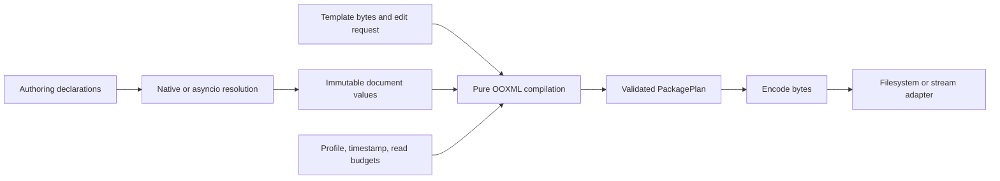

# Implemented module boundaries

Version 0.2 implements the reorganization described in
[REORGANIZATION.md](REORGANIZATION.md). This page describes actual code; the
[earlier review](ARCHITECTURE.md) records the starting point.

| Module | Owns | Boundary |
| --- | --- | --- |
| `authoring` | Document/section/paragraph/run/table declarations and constructors | Unresolved values and conditions belong here; no filesystem, XML or interpreter code |
| `resolution` | Native value/shared-computation/property primitives, dependency scopes, component interpreters | Consumes authoring programs and produces domain snapshots; invokes effect adapters |
| `document` | Resolved content algebra, tables, stories, resource values, formatting, units, identities and diagnostics | Standard library only; independently compiled in a boundary test |
| `ooxml` | Profile checks, compilation, WordprocessingML/DrawingML codecs, style/media catalogs and schema ordering | Receives bytes/domain/options; no filesystem reads or clocks |
| `opc` | Validated part names and relationship identities/targets, archive budgets, parsed-part cache and package write plan | No Word defaults or Word schema ordering |
| `xml` | Expanded names, namespace-aware writing, generic character/name rules and parsing budgets | Schema ordering is injected by the OOXML layer |
| `template` | Pure edit requests, scopes, token-span transformations and structural-boundary rules | Reuses text encoding, preserves untouched tokens, never calls an application renderer |
| `application` | Compile/render/save entrypoints, render options and file-template configuration | Coordinates effects and compilation |
| `adapters` | Atomic filesystem writes, asset reads, default clock, image inspection and optional PyO3 conversion | All platform/language-specific behavior |

## Shared functionality

- Expanded XML names carry namespace identity and a preferred lexical spelling.
  Imported namespace scopes remain available for opaque QName/prefix-valued
  attributes. New names select safe bindings when conventional prefixes collide.
- Generic XML character/name validation sits below codecs. Word property-order
  policy lives in `ooxml/schema.rs`; generated/changed properties are ordered
  without sorting unrelated imported children.
- OPC computes relative relationship targets from actual owners, discovers
  parts through exact relationship types, and distinguishes external targets.
  Internal target validation runs before encoding the plan. External references
  are retained/serialized and are never fetched.
- Parsed/edited XML is cached per package operation and encoded at materialization.
  Media registration indexes payload candidates, confirms byte equality, and
  supports resources outside the conventional media directory. Style identities
  are indexed once after definitions are applied.
- Story/asset/comment/drawing/style identities are distinct domain values.
  Compilation passes explicit story, source-part and width context. A body story
  spans sections; future multiple notes sharing a part will need distinct story
  contexts rather than treating a part path as universal story identity.
- Physical conversions use checked `Points`, `Twips`, `Emu` and `HalfPoints`
  helpers. Current point-valued authoring convenience fields still accept numeric
  values; codecs validate and convert them centrally.
- Rich run color/underline values are shared by both frontends. Table/border RGB
   conveniences remain the narrower existing surface, recorded in the coverage map.
- Hyperlinks extend the inline algebra with immutable display children and a
  typed external target. Both interpreters use their generic field machinery;
  the Word codec delegates owner-local relationship registration to OPC.
  Display-text projection is shared; template traversal remains on supported XML
  and retains the hyperlink boundary rather than reconstructing domain imports.
- The native Python adapter converts immutable snapshots directly into the same
  resolved domain. It does not construct ready Rust declarations or invoke a
  second resolver. Typed diagnostics replace display-text classification.

## Effects and repeatability

Rust declarations are consumed once; Python declarations may be reused with lazy
factories. Both produce snapshots that contain no producers or pending I/O.
Rust resolution and Python's I/O adapter choose the default timestamp once per
snapshot; callers can supply it explicitly. Pure compilation accepts explicit
profile/read options and can override the timestamp. Snapshot rendering does not
reevaluate user callbacks.

Local mutation of a compiler builder, XML tree or cache is contained within the
operation. It does not mutate the resolved document or imported input bytes.
`PackagePlan` exposes immutable part writes for inspection and deterministic
in-memory encoding. Path output uses a sibling temporary file and replacement
after successful compilation; streams are caller-owned effects.

Default archive limits are 10,000 entries, 64 MiB per part and 256 MiB expanded
payload. XML parsing rejects DTDs and limits depth to 256 and nodes to 1,000,000.
These are implementation policies, not claimed normative OOXML limits.

## Growth points

The crate remains a single package with explicit modules and a curated facade.
The next independent crate would most plausibly be the Python extension when its
release/build lifecycle warrants it. Nothing requires that split now.

New DOCX features should extend domain content/stories/ranges, their typed
codecs, and resource/relationship registration together. Internal bookmark links,
general fields, notes, revisions and charts remain future typed authoring work; neither
an opaque imported part nor an available `StoryKind` variant proves support.
The writer has a selected property vocabulary and validation surface, not a full
runtime XSD validator. Independent schema tooling complements runtime graph and
value validation. See [OOXML.md](OOXML.md) for support and specification clauses.
