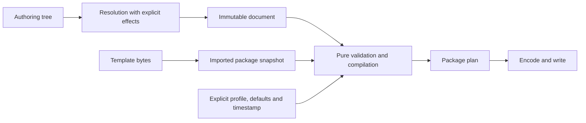

# Reorganization implementation plan

Status: implemented for the existing feature surface in version 0.2. Names in this
execution record predate the package rename to `rocx`. The ordered
work below is retained as the execution record; [MODULES.md](MODULES.md) describes
the actual boundaries and [MIGRATION.md](MIGRATION.md) records deliberate API changes.

| Milestone | Implemented evidence |
| --- | --- |
| 1 — baseline/test ownership | `tests/support/features.rs`, `tests/README.md`; independent examples/test builders |
| 2 — XML preservation | `xml` expanded names and injected ordering; namespace-shadowing/preservation regressions |
| 3 — OPC boundary | `opc` validated identities, graph/content types, budgets; relocated part/media tests; Word defaults above OPC |
| 4 — feature compilation | `ooxml` feature codecs/catalogs/context, pure compilation inputs and inspectable `PackagePlan` |
| 5 — domain | std-only `document`, explicit inline algebra, exclusive paragraph content, values/IDs/diagnostics; boundary compile test |
| 6 — resolution | separate native/asyncio interpreters, named properties/references, guards/cycles/cancellation; immutable snapshots |
| 7 — adapters/facade | direct resolved-domain conversion, optional interop, Cargo rename, curated exports and migration examples |
| 8 — templates/validation/docs | scoped structural edits, namespace/range/control preservation, independent pinned XSD/mutation tooling and standards references |

This completes the reorganization, not full DOCX feature coverage. Some numeric
conveniences retain their documented point/unit representations, with checked
conversion helpers; richer properties are introduced as features need them.
Opaque imported markup remains distinct from typed authoring support.

## Decisions and scope

- Keep a declarative interface with async values, conditions, and property
  dependencies in the authoring tree. Preserve useful behavior tests, not
  incidental compatibility quirks.
- Use a document domain built from explicit value types and algebraic data types.
  Resolve declarations into immutable domain snapshots. Keep effects at the
  application boundary; local mutation of owned compiler buffers is acceptable.
- Start with one Rust crate and optional PyO3 features. Establish module boundaries
  before considering separate crates. Add no runtime dependency as part of the
  mechanical moves; justify any later dependency against a concrete requirement.
- Retain direct OOXML generation. Keep the current Transitional namespace family
  as the first explicit output profile. Strict output and new Word extensions
  require separate support work, not silent namespace substitution.
- Reorganize the implemented surface first. Hyperlinks, notes, revisions, charts,
  and other missing features inform the design but are not prerequisites for
  completing this reorganization.
- Separate mechanical moves, correctness fixes, and public API changes into
  reviewable commits. Every merged increment must build and pass its applicable
  tests. Regression tests for known failures land together with their fixes.

## Target boundaries

| Module | Responsibility | Allowed dependencies |
| --- | --- | --- |
| `document` | Resolved document values, stories, content, ranges, styles, numbering, resource identities, invariants and units | Standard library and its own submodules |
| `authoring` | Declarative constructors, unresolved fields, conditions and property references | `document`, resolution value/reference types |
| `resolution` | Native execution of authoring programs into domain values | `document`; injected asset/application effects |
| `xml` | Expanded names, namespace scopes, XML character rules, generic parsing/writing | XML parser and standard library; no Word domain |
| `opc` | Part names, content types, relationship graph, package snapshots and ZIP mapping | `xml`, ZIP implementation; no Word defaults |
| `ooxml` | Profile-aware mapping from the document domain to a package plan; WordprocessingML and DrawingML codecs | `document`, `xml`, `opc`; no authoring callbacks or path I/O |
| `template` | Imported typed views, opaque content, edit targets and transformations | `xml`, `opc`, shared OOXML codecs; no dependency on authoring or a top-level renderer |
| `application` | Coordinate resolution, template loading, compilation, clock/default selection and output | The modules above and injected I/O adapters |
| `adapters` | Filesystem/stream/asset access, Python conversion and diagnostics translation | Application/domain contracts and relevant external libraries |

A relationship graph and a Word document are distinct models. `StoryId`,
`CommentId`, `DrawingId`, `StyleId`, `PartName`, and owner-scoped
`RelationshipId` must have distinct types and allocation rules.

Avoid circular module ownership: `resolution` interprets authoring values through
an implementation on the authoring program or a one-way internal conversion;
its generic value/reference/execution primitives must not import authoring
constructors. Template orchestration belongs in `application`, not in the shared
OOXML codecs that template edits reuse. Compilation accepts OPC snapshots and
OOXML-owned views, not types owned by `template`; this keeps template edits and
compilation from importing one another.

The intended flow is:

## Ordered increments

### 1. Establish the baseline and test ownership

**Work**

- Record the current Rust, Python, DOCX-readback and wheel checks, including how
  optional Python features are built. Preserve fixture provenance.
- Group reusable builders and readers under test support; remove the dependency
  from integration tests on `examples/support`. Examples remain consumer demos.
- Identify which tests assert domain behavior, serialization, preservation, or
  language resolution. Keep current checks active until their corresponding
  behavior is deliberately changed.
- Add a concise module/dependency guide and choose repeatable profile/default/
  timestamp inputs for deterministic comparisons.

**Exit gate:** the existing behavior suite still passes; tests and examples build
independently of one another's implementation helpers. No public API change.

### 2. Repair XML identity and preservation

**Work**

- Replace prefix-string identity in `src/xml.rs` with expanded names and explicit
  namespace scope handling. Keep QName/prefix-valued attributes and opaque
  imported markup tied to their namespace environment.
- Add the confirmed namespace-shadowing regression and additional fixtures for
  alternate prefixes, nested/default namespace bindings, extension attributes,
  and MCE prefix lists.
- Separate imported nodes from generated/edited nodes. Emit schema order for
  generated properties without recursively normalizing all imported content.
- Move generic character validation out of `render.rs`. Document the preservation
  guarantee for untouched parts versus edited XML.

**Exit gate:** the shadowing probe preserves expanded names; modified parts retain
unrelated extension semantics; existing generated output and template checks pass.

**References:** [XML and MCE](OOXML.md#xml-and-compatibility), P3 §§7–9; property
content models in P1 and normative Annex A.1.

### 3. Establish the OPC package boundary

**Work**

- Split generic package loading from Word defaults currently in `Package::load`.
- Introduce validated part names, relationship IDs/types and distinct internal/
  external targets; centralize target resolution and relativization.
- Discover the main part from the package relationship. Replace filename-based
  assumptions and follow relationships for supported story parts.
- Move default Word styles/settings/theme/numbering seeding above OPC. Expose an
  imported package snapshot that retains untouched payload bytes.
- Add explicit expanded-byte/part-count/depth budgets and typed package errors.

**Exit gate:** a relocated main part, header/footer, and media directory work;
relationships resolve from their actual owners; malformed targets fail clearly;
OPC code has no Word-default construction. All prior package/template tests pass.

**References:** [OPC and part identity](OOXML.md#packaging-and-part-identity),
P2 §§6.2, 6.4–6.5 and P1 §11.3.10.

### 4. Extract shared codecs and split compilation by feature

**Work**

- Split `render.rs` into WordprocessingML text/paragraph/table/section/story
  codecs, DrawingML picture codecs, metadata handling and orchestration.
- Share text-span encoding with template replacement; remove template/OPC calls
  back into the top-level renderer.
- Centralize checked unit conversions, style lookup, media registration and
  identifier registries. Keep each registry's scope explicit.
- Pass story/source-part/profile/resource context explicitly to codecs. Parse an
  edited part once per operation instead of once per inserted feature.
- Introduce an internal package-edit plan and validate the final graph before
  writing; keep compatibility wrappers around existing output entrypoints.

**Exit gate:** generated content is semantically unchanged; codecs contain no
filesystem reads or implicit clocks; package plans are inspectable and
repeatable for fixed inputs. Comments/media use their owning context.

**References:** [WordprocessingML](OOXML.md#wordprocessingml-domain-map),
[DrawingML](OOXML.md#drawingml-and-shared-vocabularies), P2 §6.5.

### 5. Introduce the pure document domain through vertical slices

**Work**

- Create `document` values for the implemented stories, sections, paragraphs,
  inline content, tables, formatting, styles, numbering and resources.
- Normalize shorthand paragraph text to inline content; authoring uses an
  exclusive content source instead of two independent optional fields. Images,
  tabs and breaks become explicit inline variants, not text runs with spare tags.
- Introduce checked units, richer formatting values, typed IDs and references.
  Start with existing supported properties; do not implement the full schema now.
- Add range identities and context rules sufficient for existing comments, while
  leaving room for bookmarks/revisions without pretending every range nests.
- Migrate paragraphs/text first, then pictures, tables, sections/stories, and
  styles/numbering. Each slice reaches real Rust and Python output. Use temporary
  one-way adapters, then remove them after the final slice; avoid maintaining two
  permanent document models or duplicate serializers.
- Make compilation a deterministic function of domain values, imported package
  views, and explicit options. Return structured diagnostics with locations and
  rule identities, rather than message-prefix classifications.

**Exit gate:** the entire current feature surface compiles from the new domain;
`document` contains no XML/ZIP/Python types, futures, source paths awaiting reads,
or filesystem/clock access. Domain tests exercise invariants directly.

**References:** [formatting and units](OOXML.md#formatting-and-units) and each
feature's entry in the standards map.

### 6. Redesign authoring and align resolution semantics

**Work**

- Build ergonomic declarations over the resolved domain, with a consistent field
  abstraction for immediate, lazy and async values, including formatting fields.
- Give nodes stable identities. Distinguish shared computations (`Deferred<T>`)
  from references to declared properties (`PropertyRef<T>`); retain convenient
  Python field-name references over validated descriptors.
- Keep per-pass property computation once-only, property-level dependency waits,
  declaration-order-independent output, and rejection of graph cycles. A reference
  checks its source node's condition; an excluded explicit source produces a
  structured error. Normal traversal still skips excluded subtrees.
- Define cancellation ownership: a cancelled consumer must not poison another
  active consumer of the same field; cancelling the pass cancels and drains its
  owned tasks. Explicit externally held computation handles retain their stated
  lifetime semantics.
- Treat raw futures/coroutines as single-use; use factories for repeatable passes.
  Per-pass property references and explicitly memoized computation handles have
  different, documented cache lifetimes. Neither is an automatic reactive update.
- Return new immutable resolved values from Python resolution instead of mutating
  declarations or adding `_active` flags. Keep asyncio and native-future
  interpreters separate, with shared contract scenarios and native domain rules.

**Exit gate:** both languages pass equivalent dependency, condition, cache,
error and cancellation scenarios; repeated rendering of a snapshot does not run
producers again. Changed resolution APIs have migration examples.

### 7. Simplify language adapters and the public facade

**Work**

- Partition `python_bindings.rs` conversion/diagnostics by document feature.
  Convert resolved Python snapshots directly into the native resolved domain;
  remove the second ready-value Rust resolution pass.
- Curate public exports instead of exposing every implementation type through
  wildcards. Remove incidental quirks, including the extra excluded final section,
  through explicit behavior changes and updated tests.
- Retain Rust/Python idiomatic constructors over the same domain semantics;
  constructor syntax need not match between languages.
- Align the Cargo package with the repository name (`rv-docx-rs`, imported in
  Rust as `rv_docx_rs`); retain Python's `rv_docx` import. Update examples and
  document the breaking import change in a dedicated release step.
- Separate native Python bytes/save from optional python-docx interoperability.
  Move Python resolution into its own package module and keep document
  declarations focused on authoring syntax. Continue to use uv/maturin.

**Exit gate:** Rust examples, Python examples, optional interoperability, and a
clean wheel install work. Diagnostics preserve meaningful exception types.
Historical constructor-equality tests are replaced where intentional changes
make them obsolete; content/preservation evidence remains.

### 8. Complete template edits, validation and documentation boundaries

**Work**

- Expose explicit template edit targets and preservation policy. Reuse story
  traversal and text-span codecs; define edit boundaries around fields,
  hyperlinks, controls and revisions. Reject unsupported edits clearly.
- Add profile-aware schema/content-model checks and cross-part validation.
  Introduce an independent validator as pinned development tooling, not a runtime
  dependency. Keep python-docx expected-content tests and mutation controls.
- Group test entrypoints by domain, resolution, OPC/XML, feature serialization,
  templates and interoperability. Retain Cargo-discoverable entrypoints when
  moving helpers/cases into subdirectories.
- Update the standards coverage matrix and attach edition/clause references to
  each feature codec, invariant and conformance test. Record extension revisions
  and producer/version provenance for imported fixtures.
- Remove migration adapters and dead modules; reconcile documentation with the
  actual final module layout and public API.

**Exit gate:** the two confirmed failures are fixed; all implemented features have
explicit generation/editing/preservation status and specification references;
validation detects wrong element order and broken references; no stale migration
path or undocumented behavioral fork remains.

The next feature after the reorganization can be hyperlinks: they exercise rich
inline content and external relationships without requiring an unrelated large
feature implementation to prove the new boundaries.

## Source migration map

| Current code | Eventual owners |
| --- | --- |
| `model.rs` | `authoring`, `document`, `application` for resolve/compile/save orchestration |
| `value.rs` | `resolution` value/reference primitives and native execution |
| `types.rs` | Domain formatting/units, sections, styles and numbering modules |
| `components.rs`, `table.rs` | Corresponding authoring/domain feature modules; effects in application/adapters |
| `render.rs` | `ooxml/wordprocessing`, `ooxml/drawing`, properties and application orchestration |
| `format.rs`, `styles.rs` | Pure OOXML codecs plus domain rules/value types |
| `package.rs` | `opc`; Word-default seeding in OOXML/application setup |
| `xml.rs` | `xml` names, scopes, trees and codecs |
| `template.rs` | Template edit operations using shared OOXML codecs |
| `python_bindings.rs` | Python adapters by feature and typed diagnostics translation |
| Python `base.py` | Declaration/reference facade plus separate asyncio resolution package |
| Python `document.py` | Authoring entrypoint, application calls and interop conveniences |

## Delivery and review rules

Each numbered increment is a milestone, not a requirement to make one large PR.
Use small PRs inside a milestone, especially for namespace handling, OPC graph
migration, and each domain vertical slice. Avoid unrelated renames in a semantic
fix. Keep the repository green and remove temporary bridges as soon as their
last caller migrates. Do not gate correctness fixes on the final public API.

At each milestone, run relevant focused tests, then the Rust suite/doctests,
Python binding suite and cross-language file checks when their paths changed.
Run formatting/lint checks for code changes and build Rust documentation with
warnings denied for doc changes. Recheck a clean installed wheel when native
conversion, Python packaging, or public imports change. Do not replace semantic
assertions with ZIP-byte equality or compare output only to our own decoder.

Use a fixed profile/timestamp for deterministic codec assertions. Semantic
normalization must not erase the element-order, namespace or relationship rules
being tested. Keep performance work tied to representative documents; the design
does not require cloning entire package snapshots or adding persistent data
structure dependencies.

The reorganization is complete when the boundaries above are real in code, all
current features use one resolved domain and shared compilation infrastructure,
effects are explicit, both declarative frontends have documented semantics, and
the [OOXML documentation policy](OOXML.md#documentation-and-contribution-policy)
is applied. It does not by itself establish full DOCX feature support.
